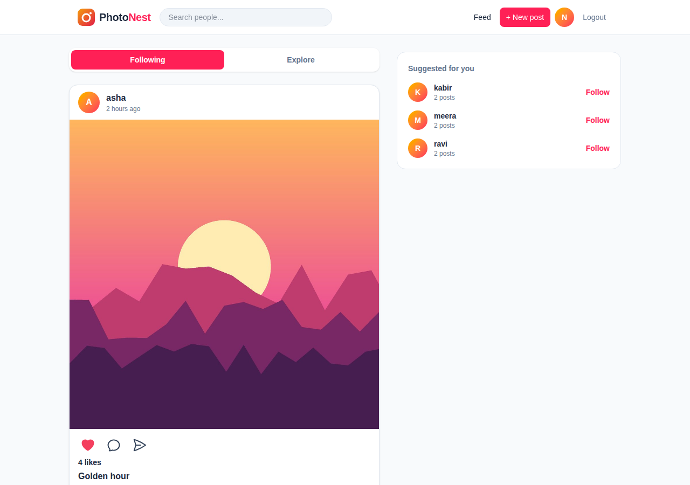
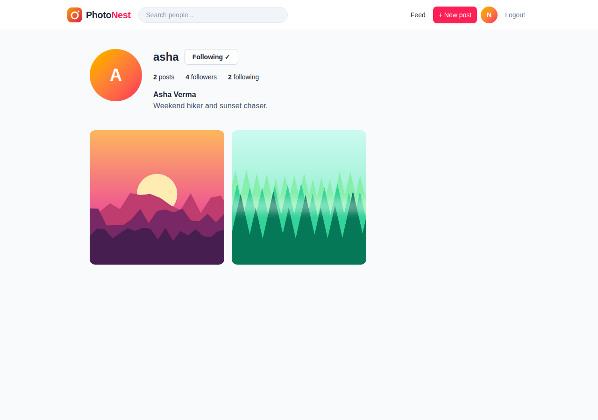
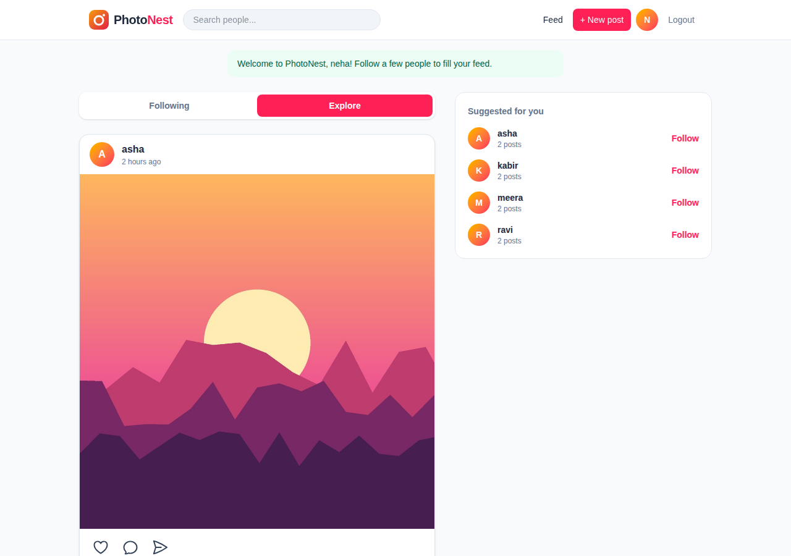
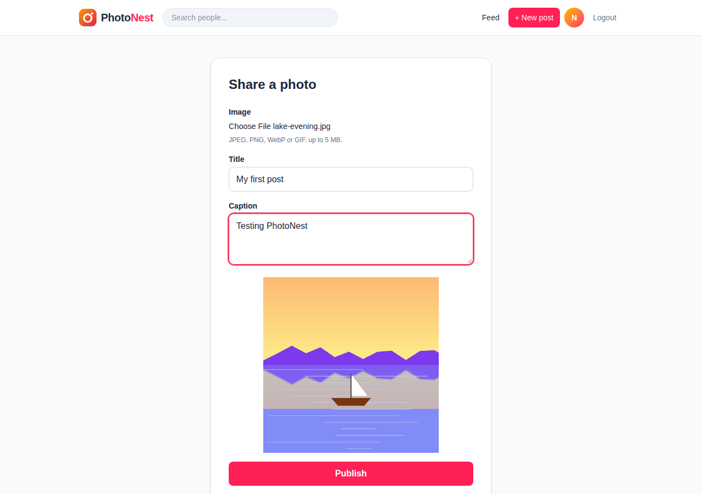

# PhotoNest - Photo sharing app built with Django

[](https://github.com/Manish12858/photonest/actions/workflows/ci.yml)


PhotoNest is an Instagram-style photo sharing website. You can sign up, share photos,
follow other people, and like and comment on their posts. I started it while learning Django
and kept adding to it: a follow system, profile pages, image resizing, tests and CI.

| Feed | Profile |
|------|---------|
|  |  |
| **Explore** | **New post** |
|  |  |

## Features

- Sign up, log in, log out, change password and reset a forgotten password
- Share a photo with a title and caption (large photos are resized, uploads over 5 MB are rejected)
- **Follow** other users. The feed has two tabs: *Following* and *Explore* (everyone), with pagination
- Like and unlike posts without reloading the page
- Comment on posts and delete your own comments (post owners can delete comments on their posts)
- Public profile pages (`/users/@username/`) with bio, photo grid and follower counts
- A page for each post, so you can copy and share its link
- Search for people by username or name
- "Suggested for you" list of people to follow
- Django admin for users, posts, comments and follows

## Tech stack

- Python 3.12 and Django (5.2 or 6.0)
- SQLite
- Tailwind CSS (loaded in the page, so there is no Node build step)
- Pillow for image uploads and resizing
- A little plain JavaScript (`fetch`) for likes and copying links
- pytest, pytest-django and Playwright for tests, GitHub Actions for CI

## How to run it

You need Python 3.10 or newer.

```bash
git clone https://github.com/Manish12858/photonest.git
cd photonest

python3 -m venv .venv
source .venv/bin/activate        # on Windows: .venv\Scripts\activate

pip install -r requirements.txt
python manage.py migrate
python manage.py seed_demo       # optional: adds demo users, photos, likes and comments
python manage.py runserver
```

Open http://127.0.0.1:8000/ and create an account, or log in as one of the demo users
(`asha`, `ravi`, `meera` or `kabir`) with the password `photonest-demo`.

To use the admin site at `/admin`, create a superuser with `python manage.py createsuperuser`.

Password reset emails are not really sent. They are printed in the terminal
where the server is running, so you can copy the reset link from there.

### Settings

The project works without any setup, but these environment variables can be set
(there is an example in `.env.example`):

| Variable | What it does | Default |
| --- | --- | --- |
| `DJANGO_SECRET_KEY` | Django secret key | a development-only key |
| `DJANGO_DEBUG` | Turn debug mode on or off | `True` |
| `DJANGO_ALLOWED_HOSTS` | Comma separated list of hosts | `localhost,127.0.0.1` |
| `DJANGO_SERVE_MEDIA` | Let Django serve uploaded photos | `True` |

## Running the tests

```bash
pip install -r requirements-dev.txt
python -m playwright install chromium    # only needed for the browser test

pytest                  # all tests
pytest -m "not e2e"     # skip the browser test
pytest -m e2e --headed  # watch the browser test
```

The browser test signs up a new user, follows someone, likes and comments on a post and
shares a photo. GitHub Actions runs all the tests on every push, and the screenshots above
are taken by that test.

## Project structure

```
photonest/        settings and main urls
users/            sign up, login, profiles, follow system, search
posts/            posts, likes, comments, feed, image resizing, seed_demo command
templates/        base layout and shared parts (post card, avatar, form fields)
tests/            pytest tests, tests/e2e has the Playwright test
```

Main models: `Profile` (one per user), `Follow` (who follows whom, unique and no
self-follows), `Post` (with a many-to-many `liked_by`) and `Comment`.

## What I learned

- How Django's built-in authentication works (login, logout, password change and reset views)
- Using `ModelForm` for forms and handling image uploads with `ImageField` and Pillow
- Model relationships: `OneToOneField`, `ForeignKey`, `ManyToManyField`, and a `Follow` model with database constraints
- Writing a data migration when I changed comments from storing a username to a `ForeignKey`
- Avoiding the N+1 query problem with `select_related`, `prefetch_related` and `annotate`
  (there is a test that checks the feed doesn't make more queries when there are more posts)
- Protecting views with `login_required` and only allowing POST for actions like like, follow and delete
- Sending a POST request from JavaScript with the CSRF token
- Testing with pytest-django and Playwright, and running tests in GitHub Actions

## Things I want to add next

- Followers / following lists
- Notifications when someone likes or comments on your post
- Infinite scroll instead of pages
- Deploy it online with PostgreSQL and cloud storage for photos

## Author

**Manish Kumar** | [GitHub](https://github.com/Manish12858) | manishkumarjamia@gmail.com

Icons are from [Heroicons](https://heroicons.com) (MIT). Demo photos are illustrations made for this project.
